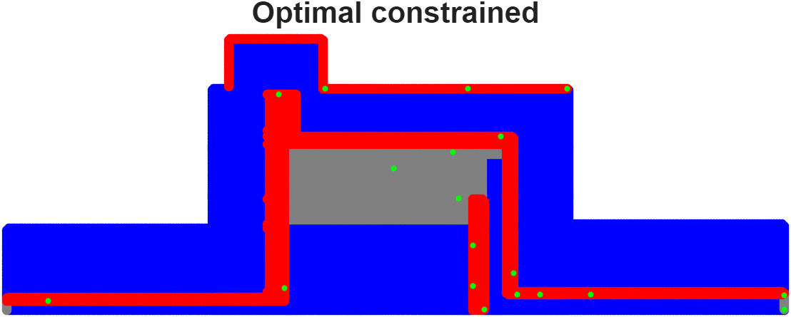

# TALL-3D sensor placement demo

Run `main_demo` from MATLAB to reproduce the demo plots for the TALL-3D lead-bismuth eutectic test section. The script uses MATLAB and the Statistics and Machine Learning Toolbox (`pdist2`). It reads the mesh and three temperature blocks from `demo/`.

The 216 snapshots contain temperatures at 49,009 mesh nodes. The script fits the POD basis to 184 randomly selected snapshots and tests field reconstruction on the remaining 32. The 99.9% variance threshold retains 19 modes in this subset. Seven layouts are compared, including the original TALL-3D thermocouples and three random placements. The default uses the supplied 44-node oversampled layout. Recomputing it with the optional switch forms a large dense matrix.

The paper is available as [arXiv:2509.10055](https://arxiv.org/abs/2509.10055). To request the complete flow-field dataset, email Xicheng Wang at [xicheng@kth.se](mailto:xicheng@kth.se).

## Reconstruction with noise

At noise level λ, each sensor has a fixed bias sampled uniformly from [−λ, λ] K and independent Gaussian reading errors with standard deviation 0.25λ K. The bias persists across the test snapshots. The NMSE plot shows the mean and one standard deviation over ten trials at each level. It retains the original demo's normalization by the squared norm of the predicted field at each snapshot.

## Outputs

- `Figures/demo/` contains the POD spectrum, individual mode plots, seven sensor layouts, the NMSE curve and the coefficient scatter plots. As in the original script, the coefficient plots use noise-free readings from test snapshots for unconstrained placement and training snapshots for constrained placement.
- `Output/demo/` contains the selected optimal sensor indices, the training/test split and the reconstruction-error arrays.

The MATLAB code is distributed under the [MIT License](LICENSE).